  

# 🌐 Awesome Cloud Data Management Web Console 🚀

**A curated, production-ready directory of Cloud Data Management Consoles, Database Administration Web UIs, SQL Workspaces, and DevSecOps Platforms.**

  <strong>🌟 Star this repository if it helps your database administration or cloud operations! 🌟</strong>

---

## 📖 Introduction & Scope

Welcome to the definitive, SEO-optimized index for **Cloud Data Management Web Consoles**, **Database Administration (DBA) Portals**, **Web SQL Editors**, and **Database DevSecOps Change Platforms**. 

Whether you are managing multi-tenant cloud data warehouses across AWS, GCP, and Azure, orchestrating Kafka streaming pipelines, inspecting PostgreSQL/MySQL databases with zero-install PHP scripts, or establishing automated GitOps schema migrations with fine-grained access control, this list catalogues the industry leaders across both commercial SaaS and 100% self-hosted open-source software.

> **💡 Key Takeaway**: The cloud landscape bifurcates between **hyperscale provider consoles** (AWS, Azure, Google Cloud) built for holistic infrastructure, **specialized data cloud workspaces** (Snowflake, Databricks, MongoDB Atlas, Confluent) offering native SQL and analytics environments, and **open-source database management consoles** (CloudBeaver, pgAdmin, Bytebase, NocoDB) that deliver self-hosted, vendor-neutral control.

---

## 📑 Table of Contents

- [📈 Sector Overview & Market Dynamics](#-sector-overview--market-dynamics)
- [☁️ SaaS / Hosted Cloud Platforms](#️-saas--hosted-cloud-platforms)
- [🌟 Open-Source GitHub Projects](#-open-source-github-projects)
- [🏛️ Architectural Taxonomy & Selection Guide](#️-architectural-taxonomy--selection-guide)
- [🤝 How to Contribute](#-how-to-contribute)
- [💖 Support & Sponsorship](#-support--sponsorship)
- [⭐ Star History](#-star-history)
- [⚖️ Disclaimer & Compliance](#️-disclaimer--compliance)

---

## 📈 Sector Overview & Market Dynamics

The global cloud-based data management services market is estimated at **$43.8 billion to $49.9 billion** (projected to exceed $65 billion by 2026 at a 26%+ CAGR). The market structure exhibits a hybrid dynamic: it is **highly concentrated (oligopolistic)** at the foundational cloud infrastructure and compute layer led by hyperscalers (Microsoft Azure, AWS, Google Cloud), but **moderately-to-highly fragmented** at the specialized data management, modern data stack, and administration UI layer where specialized vendors (Databricks, Snowflake, MongoDB, Supabase, Confluent) compete aggressively.

---

## ☁️ SaaS / Hosted Cloud Platforms

| 🏢 Company / Product | 💰 Company Size (Valuation / Market Cap) | 🏷️ Starting Tier Pricing | 🎁 Free Tier / Trial Limits | 📝 Description & Best For |
| :--- | :--- | :--- | :--- | :--- |
| **[Microsoft Azure Portal](https://portal.azure.com/)** | ~$3.6T Market Cap (Public: MSFT) | Pay-as-you-go: VM instances start at ~$0.0104/hr (~$7.50/mo for B1s); Console access is included | **$200 credit** (valid for 30 days) + **12 months free** of 55+ services (including 750 hrs/mo B1s VM, 250 GB SQL Database, 5 GB Blob storage) + Always-Free tier (e.g. 1M Azure Functions calls/mo). | **Unified web console** for all Azure resources with Copilot AI integration, activity monitors, and customizable dashboards. Best for Microsoft-centric enterprise ecosystems. |
| **[Google Cloud Console](https://console.cloud.google.com/)** | ~$2.3T Market Cap (Public: GOOGL) | Pay-as-you-go: Compute instances start at ~$0.007/hr (~$5.20/mo for e2-micro after free tier); Console access is included | **$300 free trial credit** (valid for 90 days) + **Always Free tier** (1 free `e2-micro` VM per month in US regions, 30 GB standard persistent disk, 5 GB Cloud Storage, 2M Cloud Functions invocations/mo). | **Web-based console** for Google Cloud resources with customizable project dashboards, native Cloud Shell access, and AI-assisted troubleshooting. Best for Google Cloud workloads and BigQuery analytics. |
| **[AWS Management Console](https://aws.amazon.com/console/)** | ~$2.3T Market Cap (Public: AMZN) | Pay-as-you-go: Baseline instances start at ~$0.0104/hr (~$7.50/mo for `t3.micro`); Console access is included | **12 Months Free**: 750 hrs/mo of `t2.micro`/`t3.micro` EC2 instances, 750 hrs/mo single-AZ `db.t2.micro`/`db.t3.micro` RDS database + **Always Free**: 5 GB S3 standard storage, 20,000 GET requests, 1M Lambda requests/mo. | **Centralized web console** for all AWS services with unified global navigation, AWS CloudShell, and Amazon Q AI assistant. Best for AWS-native data infrastructure and cloud operations. |
| **[Databricks Workspace](https://www.databricks.com/)** | ~$134B Valuation (Dec 2025 Series L) | Premium Tier starts at **$0.15 / DBU** for Jobs Compute, **$0.22 / DBU** for SQL Data Warehousing, and **$0.40 / DBU** for Interactive All-Purpose Compute (plus underlying cloud compute) | **14-day free trial** with full platform evaluation access (Premium workspace); also provides a permanent **Free Edition** restricted to serverless compute, 1 small 2X-Small SQL warehouse, and 5 concurrent tasks. | **Unified analytics and AI workspace** with interactive notebooks, native SQL editor, Lakeview dashboards, and Genie conversational assistant. Best for enterprise lakehouse architectures, Spark engineering, and ML. |
| **[Snowflake Snowsight](https://www.snowflake.com/)** | ~$50B Market Cap (Public: SNOW) | Standard Edition starts at **$2.00 per capacity credit**; Enterprise Edition starts at **$3.00 per credit**; storage billed at ~$23/TB per month | **30-day free trial** with **$400 in free usage credits** to explore all data warehousing, SQL Worksheets, and Snowsight capabilities without upfront commitments. | **Web-based UI for Snowflake** featuring Worksheets, Notebooks, interactive data dashboards, and Cortex AI integration. Best for Snowflake data warehousing, ad-hoc SQL exploration, and governed enterprise data sharing. |
| **[MongoDB Atlas](https://www.mongodb.com/atlas)** | ~$18B Market Cap (Public: MDB) | Flex Tier starts at **$0.011 / hour** (~$8 to $30/month capped by operations/sec); Dedicated clusters (M10+) start at ~$0.08/hr (~$57/mo) | **M0 Free Cluster (Free Forever)**: 512 MB storage, shared RAM/vCPU, 1 free cluster per project on AWS/GCP/Azure with full Data Explorer web UI and aggregation pipeline builder. | **Managed MongoDB UI** with Data Explorer for visual collection browsing, document CRUD operations, and index analysis. Best for document databases and fast application prototyping. |
| **[Confluent Cloud Console](https://confluent.io/)** | ~$11B Acquisition / Valuation (Dec 2025 by IBM; CFLT) | Basic Cluster starts at **$0.00 / hr base** (pay per use: ~$0.13/GB ingress, ~$0.13/GB egress); Standard cluster starts around ~$385/mo for 24/7 dedicated throughput | **$400 free credits** valid for **30 days** for any new account; Basic cluster scales to zero and includes free schema registry tier and first eCKU dev allowances. | **Web interface for Apache Kafka and data streaming** with a visual topic message browser (up to 1M messages), clients overview, consumer lag monitoring, and Flink stream processing. Best for event-driven real-time architectures. |
| **[Supabase Studio](https://supabase.com/)** | ~$10.5B Valuation (2026 Series F / $5B 2025) | Pro Tier starts at **$25.00 / month per organization** (includes $10 compute credit covering 1 Micro instance, 8 GB database disk, 100 GB storage, and daily backups) | **Free Forever Tier**: 2 active projects, 500 MB database storage, 1 GB file storage, 50,000 MAUs, 500,000 Edge function invocations (projects automatically pause after 1 week of inactivity). | **Dashboard for hosted or self-hosted Supabase projects** with visual Table & SQL editors, role-level security (RLS) policies, and database extension managers. Best for Postgres-native backend-as-a-service applications. |
| **[Elastic Cloud Console](https://www.elastic.co/)** | ~$8B Market Cap (Public: ESTC) | Standard Hosted Tier starts at **$99.00 / month** (billed as ~$0.1375/hour for 1 GB RAM / 45 GB storage baseline zone) | **14-day free trial** of Elastic Cloud Hosted or Serverless with **8 GB RAM and 240 GB storage cluster** allocation; self-managed Basic license is permanently $0 for self-hosted instances. | **Centralized management console** for provisioning, monitoring, and querying Elasticsearch and Kibana clusters across public cloud and hybrid environments. Best for log analytics, search, and observability. |
| **[SingleStore Portal](https://www.singlestore.com/)** | ~$1.3B Valuation (Private) | Standard Compute (`S-00`, 2 vCPU / 16 GB RAM) starts at **0.25 credits/hr** (~$0.99 / hour; ~$720/mo continuous); storage billed at ~$0.023/GB | **Free Shared Workspace Tier (Helios)**: Free forever with up to **1 GB compressed data** (~4 GB raw data), shared compute with automatic idle spin-down, vector search, and full SQL portal access. | **Cloud portal** with integrated SQL editor, real-time notebooks, and interactive Dashboard Apps. Best for real-time distributed SQL analytics, streaming ingestion, and hybrid vector search. |

---

## 🌟 Open-Source GitHub Projects

| 📦 Project | ⭐ Stars | 📜 License | 🛠️ Tech Stack | 🚀 Deployment | 🎯 Description & Focus |
| :--- | :--- | :--- | :--- | :--- | :--- |
| **[Supabase](https://github.com/supabase/supabase)** |  | Apache-2.0 | TypeScript, Elixir, Go | Docker, K8s, Self-hosted | **Open-source Firebase alternative & PostgreSQL platform.** Features Supabase Studio web dashboard with visual table editors, SQL query runner, RLS security builder, database migrations, and real-time triggers. |
| **[Apache Superset](https://github.com/apache/superset)** |  | Apache-2.0 | Python, TypeScript, React | Docker, Helm, Pip | **Modern enterprise business intelligence, SQL workspace, and data exploration platform.** Connects to 40+ SQL databases and engines (Presto, Trino, Snowflake, ClickHouse, Postgres) with a rich SQL Lab web IDE, metadata browser, and interactive dashboard creator. |
| **[NocoDB](https://github.com/nocodb/nocodb)** |  | AGPL-3.0 | Node.js, Vue, TypeScript | Docker, Binary, Node | **Smart spreadsheet web console for relational databases.** Turns MySQL, PostgreSQL, SQL Server, SQLite, and MariaDB into an interactive, no-code visual workspace with spreadsheet, gallery, kanban, and form views for both DBAs and business users. |
| **[Metabase](https://github.com/metabase/metabase)** |  | AGPL-3.0 | Clojure, TypeScript, React | Docker, JAR, K8s | **Simple, self-hosted web UI for database querying, analytics, and admin exploration.** Features an intuitive visual query builder as well as a full native SQL editor for querying Postgres, MySQL, BigQuery, Snowflake, and Redshift. |
| **[Directus](https://github.com/directus/directus)** |  | BSL 1.1 / Apache-2.0 | Node.js, Vue 3, TypeScript | Docker, npm | **Real-time database administration console & backend wrapper.** Connects directly to any SQL database (PostgreSQL, MySQL, SQLite, Oracle, CockroachDB) and mirrors schema into an administrative web portal with custom permissions, data workflows, and REST/GraphQL APIs. |
| **[Hasura GraphQL Engine](https://github.com/hasura/graphql-engine)** |  | Apache-2.0 | Haskell, Go, TypeScript | Docker, K8s | **Instant GraphQL and REST data access console.** Features the Hasura Web Console for browsing tables, executing GraphQL/SQL queries, configuring row-level and column-level permission rules, and managing database relationships. |
| **[Chat2DB](https://github.com/OtterMind/Chat2DB)** |  | Apache-2.0 | Java, TypeScript, Electron | Desktop, Docker, Web | **AI-native database management client and SQL workspace.** Connects to 40+ databases (MySQL, PostgreSQL, Oracle, SQL Server, ClickHouse, Redis, MongoDB). Features natural-language-to-SQL generation, query optimization, and schema visualization. |
| **[Bytebase](https://github.com/bytebase/bytebase)** |  | BSL 1.1 / Apache-2.0 | Go, Vue 3, TypeScript | Docker, Helm | **Database DevSecOps and schema change governance platform.** CNCF Landscape project providing GitOps database CI/CD, SQL linting rules (200+ rules), dynamic data masking, RBAC access control, drift detection, and centralized Web SQL editor. |
| **[RedisInsight](https://github.com/redis/RedisInsight)** |  | SSPL-1.0 | TypeScript, Electron, NodeJS | Desktop, Docker, Web | **Official visual management console for Redis.** Provides real-time interactive key-value data browsing, memory profiling, slow-log analysis, visual Workbench with auto-complete Redis CLI, and Lua script debugging. |
| **[phpMyAdmin](https://github.com/phpmyadmin/phpmyadmin)** |  | GPL-2.0 | PHP, JavaScript | Web server, Docker | **The classic web administration tool for MySQL and MariaDB.** Full web UI for managing databases, tables, columns, relations, indexes, users, and permissions, alongside SQL execution, bookmarked queries, and multi-format data exports. |
| **[Adminer](https://github.com/vrana/adminer)** |  | Apache-2.0 / GPL-2.0 | PHP | Single PHP file | **Ultra-lightweight database management tool in a single PHP file.** Minimalist zero-installation web console supporting MySQL, MariaDB, PostgreSQL, SQLite, MS SQL, Oracle, Elasticsearch, ClickHouse, and DuckDB for instant DDL/DML inspections. |
| **[mongo-express](https://github.com/mongo-express/mongo-express)** |  | MIT | JavaScript, Node.js | npm, Docker | **Web-based MongoDB administrative interface.** Lightweight self-hosted management console for browsing databases, collections, viewing/editing/inserting BSON documents, building queries, and inspecting index stats. |
| **[CloudBeaver](https://github.com/dbeaver/cloudbeaver)** |  | Apache-2.0 | Java, TypeScript, React | Docker, Server | **Comprehensive cloud database manager with web UI.** From the creators of DBeaver. Supports PostgreSQL, MySQL, MariaDB, SQLite, Oracle, ClickHouse, DuckDB, Trino, and more. Features SQL editor, ER-diagram foreign key inspector, data transfer, and AI query assistance. |
| **[Mathesar](https://github.com/mathesar-foundation/mathesar)** |  | GPL-3.0 | Python, Svelte, TypeScript | Docker | **Intuitive spreadsheet-like web interface for PostgreSQL.** Connects directly to existing PostgreSQL databases, allowing technical and non-technical teams to view, edit, query, and structure data without breaking schema or bypassing native Postgres access controls. |
| **[pgAdmin 4](https://github.com/pgadmin-org/pgadmin4)** |  | PostgreSQL License | Python (Flask), React | Desktop, Docker, Server | **Definitive web & desktop administration platform for PostgreSQL.** Comprehensive database administration for all Postgres objects, visual EXPLAIN query execution plans, graphical schema ERD tool, and server maintenance dashboards. |
| **[Attu](https://github.com/zilliztech/attu)** |  | MIT | TypeScript, React, Go | Docker, Desktop | **Official visual web management GUI for Milvus vector database.** Dedicated console for inspecting vector collections, schema definitions, similarity vector search queries, data partitions, and cluster node health. |

---

## 🏛️ Architectural Taxonomy & Selection Guide

- 🌐 **Universal Multi-Database Web Administration**: Use **[CloudBeaver](https://github.com/dbeaver/cloudbeaver)** for enterprise multi-engine connectivity with an editor experience comparable to desktop DBeaver, or **[Chat2DB](https://github.com/OtterMind/Chat2DB)** if AI-assisted SQL query generation across 40+ engines is desired.
- 🎯 **Dedicated Engine Administration**: Use **[pgAdmin 4](https://github.com/pgadmin-org/pgadmin4)** for in-depth PostgreSQL optimization, **[phpMyAdmin](https://github.com/phpmyadmin/phpmyadmin)** for MySQL/MariaDB, **[RedisInsight](https://github.com/redis/RedisInsight)** for Redis memory and key analysis, and **[Attu](https://github.com/zilliztech/attu)** for Milvus vector stores.
- 🛡️ **Database DevSecOps & Governance**: Use **[Bytebase](https://github.com/bytebase/bytebase)** for GitOps database migrations, schema review CI/CD pipelines, and role-based data masking.
- ⚡ **Emergency / Zero-Install Fallback**: Keep **[Adminer](https://github.com/vrana/adminer)** as a single PHP file for quick server troubleshooting when full containerized consoles cannot be deployed.
- 📊 **No-Code & Business Collaborative Consoles**: Use **[Supabase](https://github.com/supabase/supabase)** for full Postgres application infrastructure, **[NocoDB](https://github.com/nocodb/nocodb)** or **[Mathesar](https://github.com/mathesar-foundation/mathesar)** for spreadsheet-style collaborative views over raw databases, and **[Directus](https://github.com/directus/directus)** for dynamic API/data modeling.

---

## 🤝 How to Contribute

Contributions make the open-source community an amazing place to learn, inspire, and create! Any contributions you make are **greatly appreciated**.

1. 🍴 **Fork the Project**
2. 🌿 **Create your Feature Branch** (`git checkout -b feature/AddAwesomeConsole`)
3. 💾 **Commit your Changes** (`git commit -m 'Add new cloud data management web console'`)
4. 📤 **Push to the Branch** (`git push origin feature/AddAwesomeConsole`)
5. 🚀 **Open a Pull Request**

Please ensure that you include the product name, official website/repo link, verified license, transparent pricing/free-tier models, and factual architectural use cases.

---

## 💖 Support & Sponsorship

Thank you so much for visiting this repository! If you found this curated guide useful for your projects, infrastructure, or team, please consider supporting the project:

- ⭐ **Star this repository** to help others discover it on GitHub.
- 🍴 **Fork and share** it with fellow DBAs, data engineers, and cloud architects.
- ☕ **Buy a coffee & sponsor**: Support continuous maintenance and open-source curation via the [GitHub Sponsor Dashboard](https://github.com/sponsors/ishandutta2007).

Your sponsorship and encouragement help keep this directory accurate, up-to-date, and community-driven! 🚀

---

## ⭐ Star History

---

## ⚖️ Disclaimer & Compliance

- 📋 This is a **community-curated** list — not exhaustive and not a commercial endorsement.
- 🔒 Cloud data management consoles handling database credentials and production data must comply with international data protection regulations (GDPR, HIPAA, SOC 2, CCPA) and implement appropriate role-based access controls (RBAC), TLS in transit, encryption at rest, and audit logging.
- 🏗️ **Platform Distinctions**: Hyperscalers and data platforms (AWS, GCP, Azure, Snowflake, Databricks, MongoDB Atlas) provide hosted management consoles for their proprietary cloud ecosystems. Dedicated tools (CloudBeaver, pgAdmin, Adminer, RedisInsight) provide query and administration interfaces for existing databases. DevSecOps platforms (Bytebase) focus on change governance and GitOps migrations. Choose based on whether you need to manage cloud infrastructure, administer databases, or govern schema changes.
- 🛠️ Self-hosted open-source solutions require proper infrastructure hardening, network boundary restrictions (VPC / VPN / IP allowlisting), credential management, and regular security patching before exposing administrative interfaces to the web.

---

  Made with ❤️ for DBAs, platform engineers, and cloud data practitioners worldwide.

